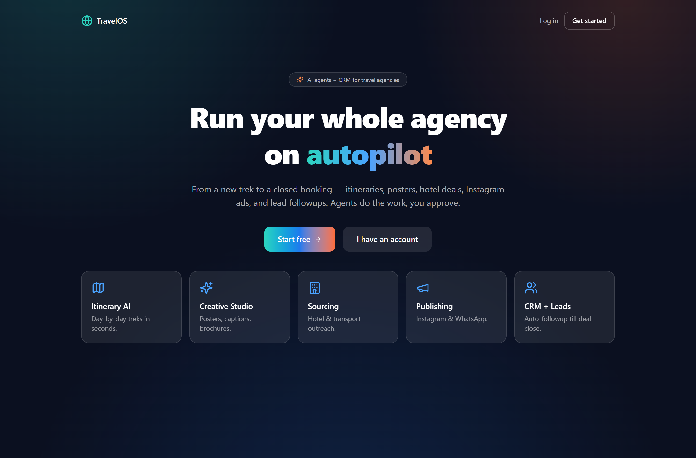
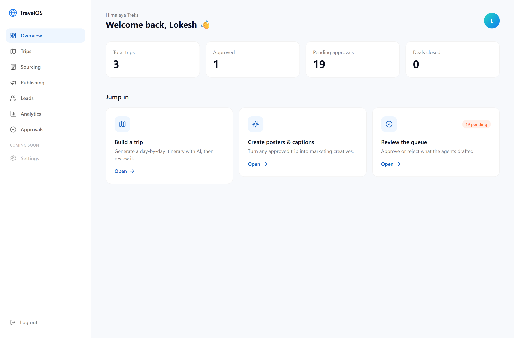
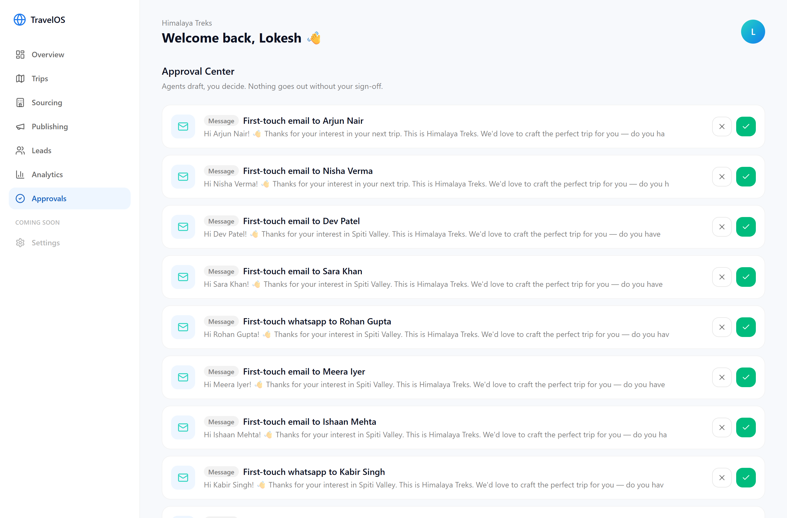
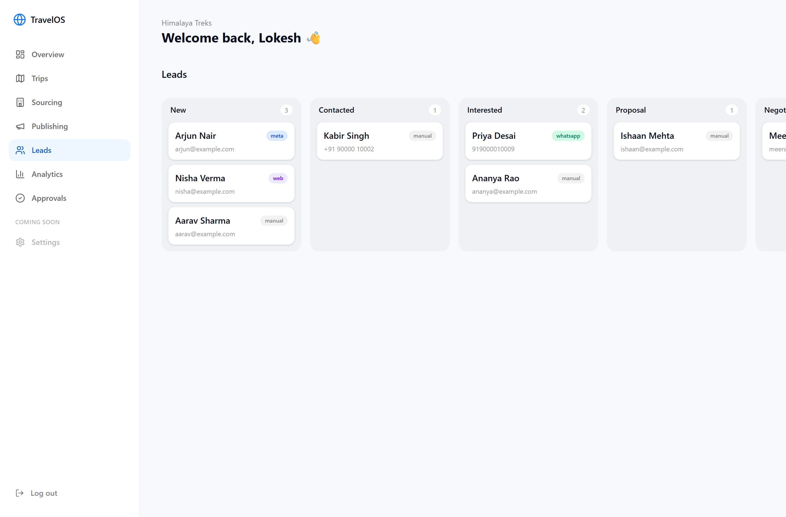
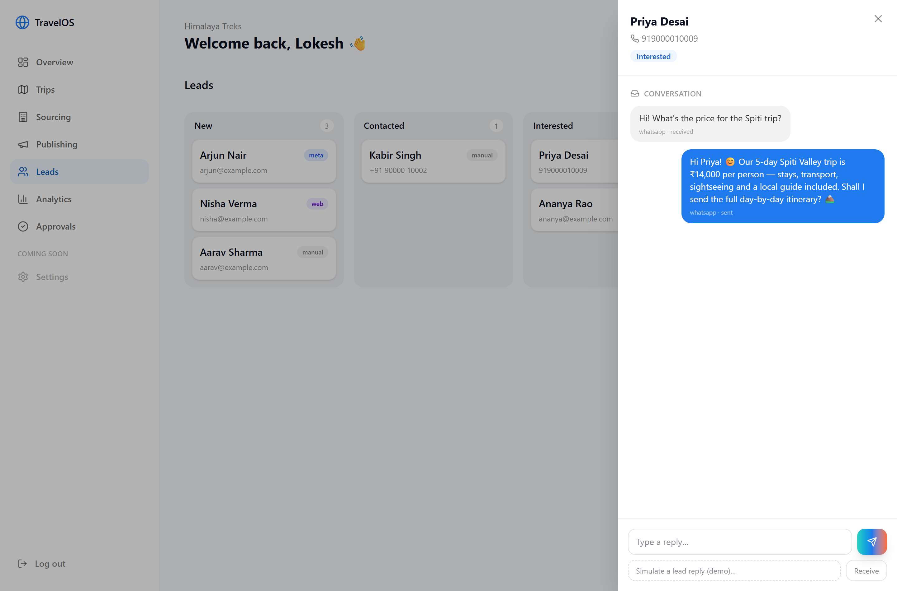
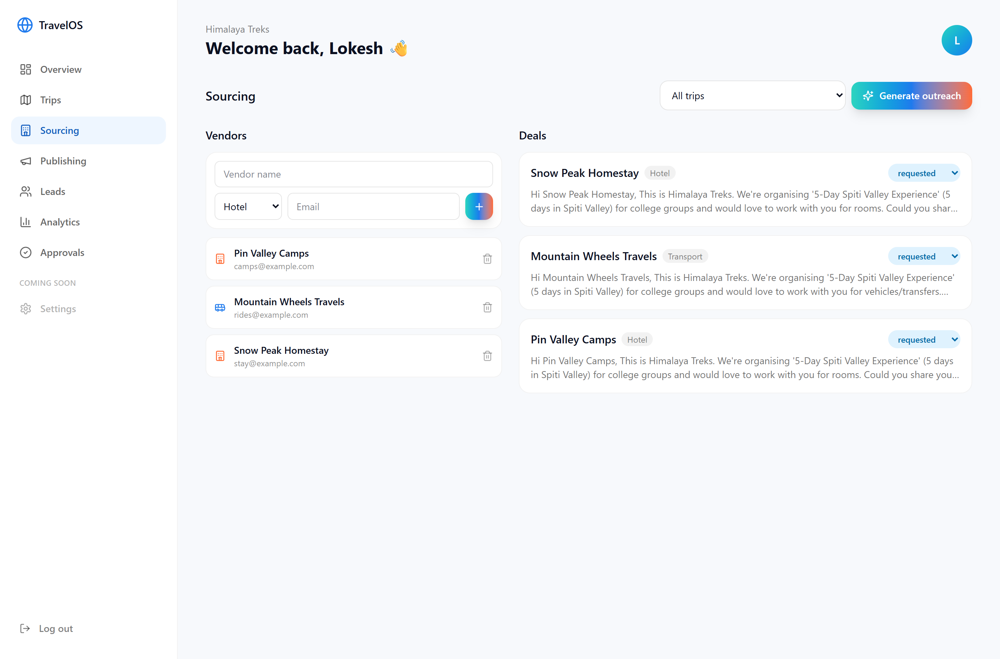
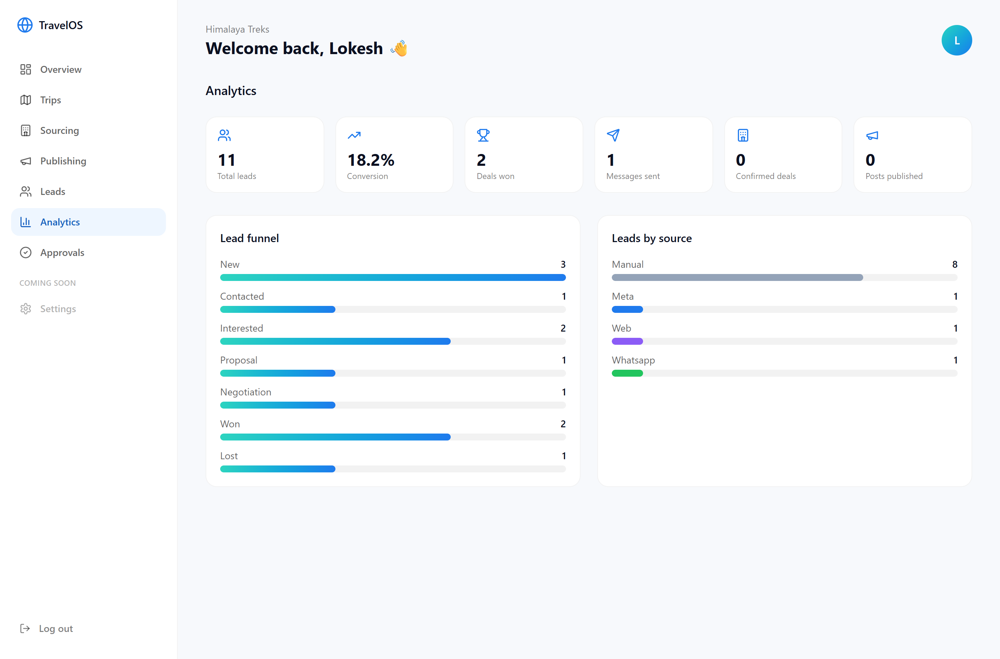
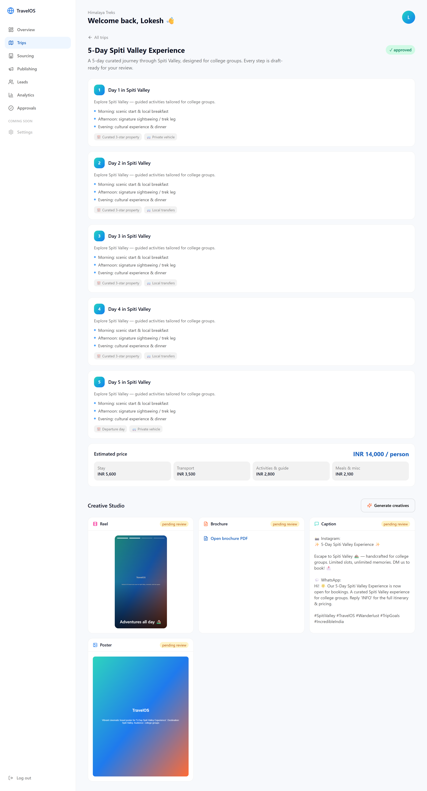
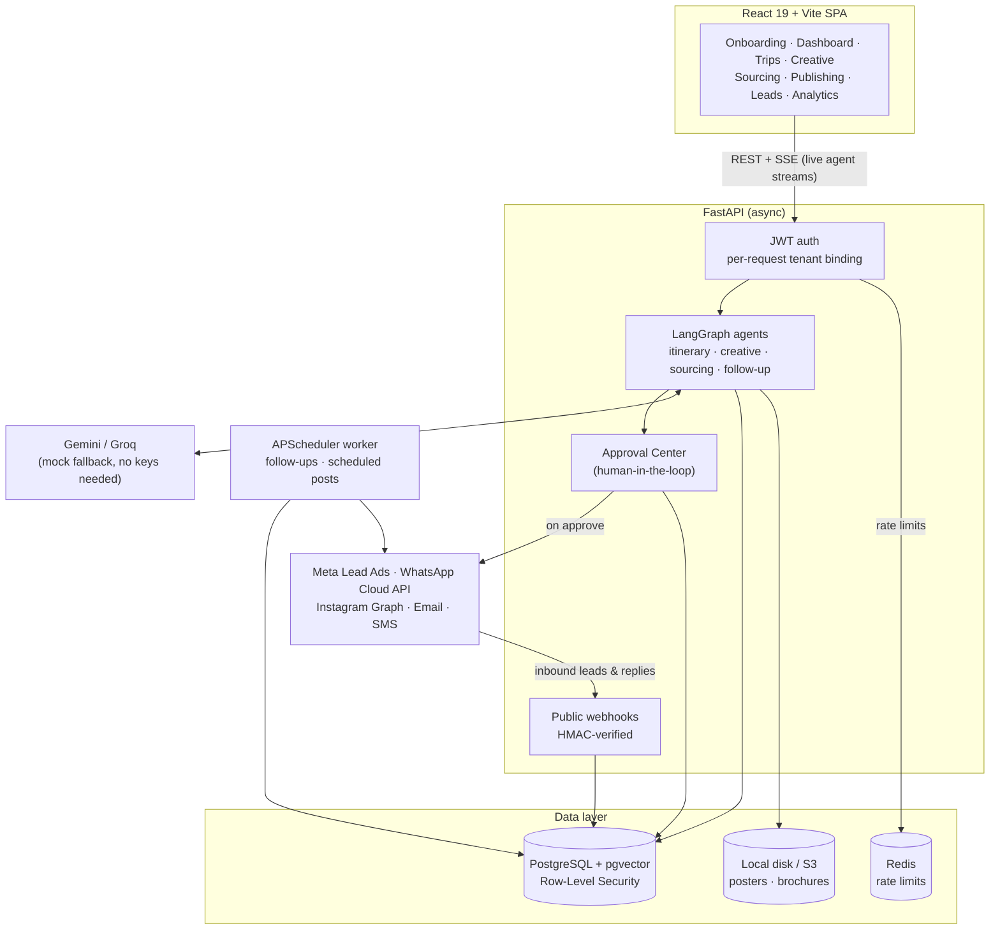
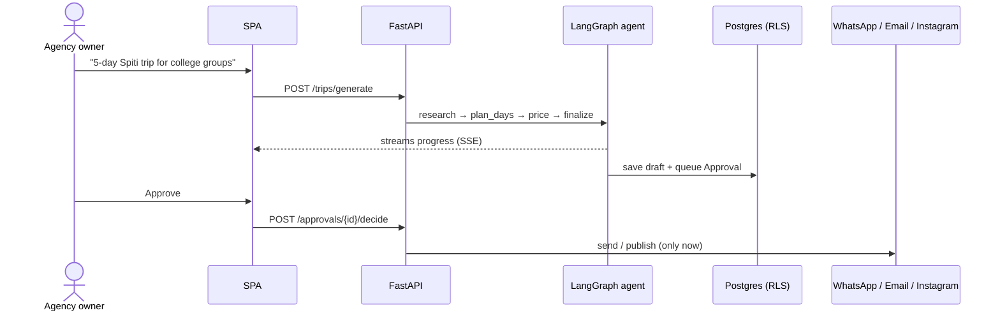

<div align="center">


# TravelOS

### The AI operating system for travel agencies

**One workspace where AI agents draft itineraries, marketing creatives, vendor deals and lead follow-ups, and a human approves every step before anything goes out.**

[](https://github.com/lokifergusion9/Travel-OS/actions/workflows/ci.yml)


<br/>



[Features](#-features) · [Screenshots](#-screenshots) · [Architecture](#-architecture) · [Engineering highlights](#-engineering-highlights) · [Quick start](#-quick-start) · [Testing](#-testing) · [Deployment](#-deployment)

</div>

---

## 🧠 The problem

Most small travel agencies are one or two people doing everything by hand: writing itineraries,
designing posters, chasing hotels for rates, posting on Instagram, and then drowning in the leads
those posts bring in.

**TravelOS turns that whole pipeline into one multi-tenant workspace.** AI agents do the grunt work.
The agency owner reviews and approves.

> **Design principle:** AI should be reliable in production, not just impressive in a demo. Every
> agent only *drafts*. No message is sent, no post is published and no vendor is emailed until a
> human clicks **approve**.

---

## ✨ Features

| | Module | What the agent does | What you do |
|---|---|---|---|
| 🗺️ | **Trip Builder** | Streams a day-by-day itinerary with stays, transport and a cost breakdown (LangGraph: research → plan → price → finalize) | Review, tweak, approve |
| 🎨 | **Creative Studio** | Generates a poster, Instagram + WhatsApp captions, a PDF brochure and a short reel for an approved trip | Pick what goes out |
| 🏨 | **Sourcing** | Drafts personalised outreach to matching hotel and transport vendors and tracks each deal | Approve, then it sends |
| 📣 | **Publishing** | Schedules and publishes posts to Instagram (Graph API) | One-click publish |
| 👥 | **CRM + Leads** | Captures leads from Meta Lead Ads, web forms and WhatsApp, classifies reply intent, drafts follow-ups | Work the 7-stage pipeline |
| 💬 | **WhatsApp inbox** | Two-way conversations via the WhatsApp Cloud API, threaded per lead | Reply from the same thread |
| ✅ | **Approval Center** | Every draft from every agent lands in a single queue | Approve or reject |
| 📊 | **Analytics** | Live lead funnel, conversion rate and source mix | Watch it grow |

---

## 📸 Screenshots

<table>
  <tr>
    <td width="50%">
      
      <p align="center"><b>Dashboard</b>: the whole agency at a glance, pending approvals front and centre</p>
    </td>
    <td width="50%">
      
      <p align="center"><b>Approval Center</b>: agents draft, you decide</p>
    </td>
  </tr>
  <tr>
    <td width="50%">
      
      <p align="center"><b>Leads CRM</b>: 7-stage pipeline, source-tagged (Meta · web · WhatsApp · manual)</p>
    </td>
    <td width="50%">
      
      <p align="center"><b>WhatsApp inbox</b>: inbound message, auto-classified intent, reply from the same thread</p>
    </td>
  </tr>
  <tr>
    <td width="50%">
      
      <p align="center"><b>Sourcing</b>: AI-drafted vendor outreach with deal tracking</p>
    </td>
    <td width="50%">
      
      <p align="center"><b>Analytics</b>: funnel, conversion % and lead sources</p>
    </td>
  </tr>
</table>

<details>
<summary><b>Trip Builder + Creative Studio (full page)</b></summary>
<br/>

</details>

<sub>Screenshots use the built-in mock AI provider and fictional demo data. Add a Gemini key for
real model output.</sub>

---

## 🏛️ Architecture



### Request lifecycle: every agent action is a draft



---

## 🧪 Engineering highlights

**Multi-tenancy enforced by the database, not just app code.**
Every business table carries a `tenant_id`, and Postgres **Row-Level Security** policies filter rows
by the tenant bound to the current request (`app.current_tenant`). The API connects as a dedicated
non-superuser role with `FORCE ROW LEVEL SECURITY`, so even a buggy query can't cross tenants. A test
proves Agency A cannot read Agency B's data.

**Human-in-the-loop by construction.**
Agents write drafts plus an `Approval` row. Outbound side effects (messages, vendor emails,
Instagram posts) only fire from the approve path, with an opt-in per-tenant auto-follow-up switch.

**Live agent streaming.**
Itinerary and creative generation stream progress over **Server-Sent Events**, so the UI fills in as
the agent works instead of waiting on one long request.

**Runs with zero API keys.**
Pluggable LLM and image providers fall back to deterministic mocks, so the whole product (and the
test suite) runs offline. Set `GEMINI_API_KEY` and real AI lights up with no code change.

**Security hardening.**
- **Signed webhooks:** Meta and WhatsApp payloads are verified with `X-Hub-Signature-256` (HMAC-SHA256); production rejects unsigned calls
- **Rate limiting:** Redis-backed per-IP limits on login, signup, token refresh and public lead capture, with an in-memory fallback if Redis is down
- **Revocable sessions:** JWTs carry a `token_version`; logout bumps it and instantly invalidates every outstanding token
- **No tokens in `localStorage`:** the refresh token lives in an `httpOnly`, `SameSite=Lax` cookie; the access token lives only in memory
- **Encrypted credentials:** per-tenant integration tokens are encrypted at rest (Fernet)
- **Fail-fast config:** production refuses to boot without real secrets

**Production-shaped.**
Gunicorn + Uvicorn workers with a separate scheduler process, S3 asset storage, Alembic migrations,
multi-stage Docker images running as a non-root user, Terraform for AWS (ECS, RDS, ElastiCache, S3,
CloudFront), and GitHub Actions CI.

---

## 🛠️ Tech stack

| Layer | Technologies |
|---|---|
| **Frontend** | React 19, TypeScript, Vite, Tailwind CSS 4, Framer Motion, React Router 7 |
| **Backend** | Python 3.12, FastAPI, SQLAlchemy 2 (async), Pydantic 2, Alembic |
| **AI / agents** | LangGraph, LangChain, Google Gemini, Groq (Llama 3.3), built-in mock providers |
| **Data** | PostgreSQL 16 + pgvector, Row-Level Security, Redis 7 |
| **Background jobs** | APScheduler (in-process for dev, dedicated worker in prod) |
| **Integrations** | Meta Lead Ads, WhatsApp Cloud API, Instagram Graph API, Resend / Brevo email, MSG91 / Fast2SMS |
| **Infra** | Docker, Docker Compose, nginx, Gunicorn, Terraform (AWS), GitHub Actions |
| **Quality** | pytest + pytest-asyncio, Vitest, ESLint, TypeScript strict mode |

---

## 🚀 Quick start

**Prerequisites:** [Docker Desktop](https://www.docker.com/products/docker-desktop/). Nothing else.

```bash
git clone https://github.com/lokifergusion9/Travel-OS.git
cd Travel-OS
cp .env.example .env        # optional: sensible defaults without it
docker compose up --build   # database migrations run automatically
```

| Service | URL |
|---|---|
| Web app | http://localhost:5173 |
| API docs (Swagger) | http://localhost:8000/docs |
| Health check | http://localhost:8000/health |

Sign up, create a trip, and the agents take it from there. Both services hot-reload from your working tree.

<details>
<summary><b>Port already in use?</b></summary>

Another project may already be using Postgres on `5432`. Change the host port in `.env`
(the app itself still talks to the database inside Docker):

```bash
DB_HOST_PORT=5433
BACKEND_HOST_PORT=8000
FRONTEND_HOST_PORT=5173
```
</details>

<details>
<summary><b>Turn on real AI</b></summary>

Get a free key from [Google AI Studio](https://aistudio.google.com/apikey), then in `.env`:

```bash
GEMINI_API_KEY=your-key
LLM_TEXT_PROVIDER=gemini
LLM_IMAGE_PROVIDER=gemini
```

Restart with `docker compose up`. Without a key everything falls back to the mock provider.
</details>

<details>
<summary><b>Useful commands</b></summary>

| Command | What it does |
|---|---|
| `make up` | Build and start the full stack |
| `make down` | Stop the stack (keeps data) |
| `make clean` | Stop and wipe the database |
| `make test` | Run backend tests in the container |
| `make logs` | Tail backend logs |
| `make migrate` | Apply database migrations |
| `make revision m="..."` | Autogenerate a new migration |
| `make db-shell` | Open `psql` |
</details>

---

## ⚙️ Configuration

All settings come from environment variables; see [`.env.example`](.env.example) for the full list.

| Variable | Default | Purpose |
|---|---|---|
| `ENVIRONMENT` | `development` | `production` enables strict secret checks and secure cookies |
| `SECRET_KEY` | — | JWT signing key (**required** in production) |
| `CREDENTIALS_ENCRYPTION_KEY` | — | Fernet key for per-tenant secrets (**required** in production) |
| `GEMINI_API_KEY` / `GROQ_API_KEY` | — | Real LLM providers; mocks are used when empty |
| `META_APP_SECRET` | — | Verifies Meta/WhatsApp webhook signatures (**required** to accept webhooks in production) |
| `RATE_LIMIT_ENABLED` | `true` | Per-IP limits on auth and public endpoints |
| `TRUST_PROXY` | `false` | Read client IP from `X-Forwarded-For` (only behind your own proxy) |
| `STORAGE_BACKEND` | `local` | `local` disk or `s3` |
| `RUN_SCHEDULER` | `true` | Run follow-ups in-process; set `false` when using the dedicated worker |
| `EMAIL_PROVIDER` / `SMS_PROVIDER` / `WHATSAPP_PROVIDER` | `console` | `console` logs messages instead of sending them |

---

## 📁 Project structure

```
TravelOS/
├── backend/
│   ├── app/
│   │   ├── agents/          # LangGraph agents: itinerary, creative, sourcing, follow-up, LLM factory + mocks
│   │   ├── api/             # Auth endpoints, dependencies (current user, tenant binding)
│   │   ├── core/            # Config, DB + RLS helpers, security, rate limiting, SSE
│   │   ├── integrations/    # Messaging (email/SMS/WhatsApp), Meta, storage (local/S3)
│   │   ├── models/          # SQLAlchemy models
│   │   ├── modules/         # Feature routers + services: trips, creative, crm, sourcing, publishing, analytics, approvals
│   │   ├── schemas/         # Pydantic request/response models
│   │   └── workers/         # APScheduler jobs + standalone worker
│   ├── alembic/             # Migrations (RLS policies live here)
│   └── tests/               # pytest suite against real Postgres
├── frontend/
│   └── src/
│       ├── pages/           # Landing, auth, onboarding, dashboard modules
│       ├── components/      # Layouts + UI primitives
│       └── lib/             # API client, auth context, SSE consumer, typed domain clients
├── infra/
│   ├── db/init.sql          # Creates the non-superuser app role + pgvector
│   └── terraform/           # AWS: ECS, RDS, ElastiCache, S3, CloudFront
├── deploy/aws-free-tier/    # One-box Docker + nginx deployment
├── docker-compose.yml       # Local dev stack (hot reload)
└── docker-compose.prod.yml  # Production-shaped stack
```

---

## ✅ Testing

```bash
# Backend: 24 tests against real Postgres (auth, tenant isolation, every agent flow,
# scheduler, webhooks, security hardening)
make test

# Frontend: lint + type-check, unit tests, production build
cd frontend
npm run lint
npm test
npm run build
```

CI runs both suites on every push, with the backend tests running against a real
Postgres + pgvector service container.

---

## ☁️ Deployment

| Target | Guide |
|---|---|
| Single server (Docker + nginx, one origin) | [`docs/AWS_FREE_TIER.md`](docs/AWS_FREE_TIER.md) |
| Full AWS production (ECS · RDS · ElastiCache · S3 · CloudFront via Terraform) | [`docs/DEPLOY.md`](docs/DEPLOY.md) · [`infra/terraform`](infra/terraform) |

Before going live, set `ENVIRONMENT=production`, `SECRET_KEY`, `CREDENTIALS_ENCRYPTION_KEY` and
`META_APP_SECRET`. The app refuses to start without the first two.

---

## 🗺️ Roadmap

- [x] Multi-tenant auth, animated onboarding, dashboard shell
- [x] Trip + Creative agents (itinerary, posters, captions, brochure, reel)
- [x] CRM + leads (Meta webhook, web capture, email/SMS follow-ups, pipeline)
- [x] Vendor sourcing + Instagram publishing
- [x] WhatsApp two-way inbox and analytics
- [x] Production setup: Gunicorn + worker, S3, Docker, Terraform, CI
- [x] Security hardening: signed webhooks, rate limits, revocable JWTs, httpOnly refresh cookie
- [ ] Settings page (integrations, team members, auto-follow-up)
- [ ] Route webhooks by Meta Page / WhatsApp number instead of tenant slug
- [ ] RAG over past itineraries and vendor history (pgvector)
- [ ] Team roles and per-user permissions

Design notes: [`docs/PLAN.md`](docs/PLAN.md)

---

<div align="center">

**Built by Lokesh Kumar** · [@lokifergusion9](https://github.com/lokifergusion9)

If this project is useful to you, a ⭐ helps.

</div>
